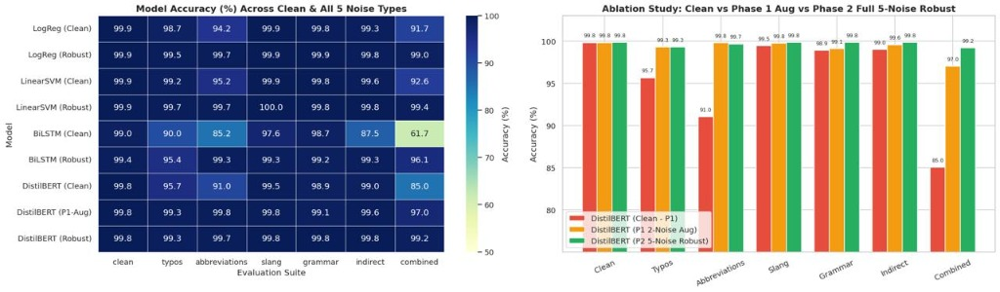
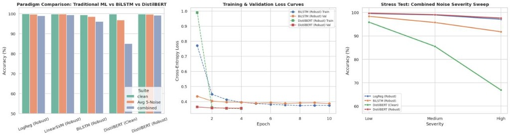
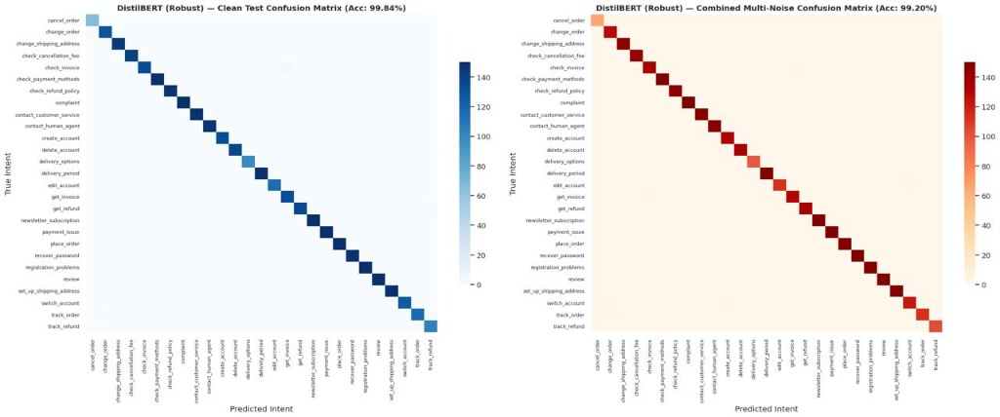
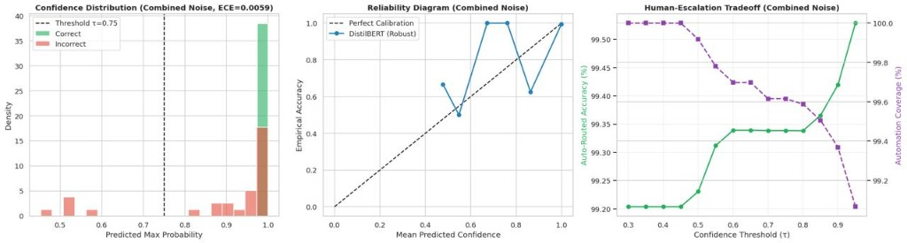

# Noise-Robust Customer Support Intent Classification

[](https://www.python.org/)
[](https://pytorch.org/)
[](https://huggingface.co/distilbert-base-uncased)
[](https://huggingface.co/datasets/bitext/Bitext-customer-support-llm-chatbot-training-dataset)

An end-to-end **27-class customer support intent classification system** engineered to stay accurate and well-calibrated under real-world noisy user inputs — including **typos, abbreviations, slang, grammatical errors, indirect language, and combined multi-noise**.

---

## Highlights

| Metric | DistilBERT (Clean Baseline) | DistilBERT (Robust — Final) | Gain |
|---|:---:|:---:|:---:|
| **Clean Test Accuracy** | 99.8% | **99.84%** | `0.0 pp` (no clean loss) |
| **Combined Multi-Noise (Medium)** | 85.0% | **99.20%** | **+14.2 pp** |
| **High-Severity Combined Noise** | ~67.0% | **~97.5%** | **+30.5 pp** |
| **Calibration Error (ECE)** | — | **0.0059** | Safe human escalation |

- **Three Modeling Paradigms Compared:** Traditional ML (Word+Char TF-IDF + Logistic Regression & Calibrated Linear SVM), Deep Learning RNN (2-Layer BiLSTM with Self-Attention), and Fine-Tuned Transformers (`distilbert-base-uncased`).
- **All 5 Real-World Noise Types + Combined Stress Test:** Typos, Abbreviations, Slang, Grammatical Errors, Indirect Language, and stacked Multi-Noise across `Low`, `Medium`, and `High` severity.
- **Confidence Calibration & Human-Agent Escalation:** Label smoothing (`0.05`) + post-hoc Temperature Scaling lowers ECE to `0.0059`, lifting auto-routed accuracy from `99.20%` to `99.53%` while automating ~99.1% of tickets.
- **Self-Contained Training & Live Dashboard:** Single-file notebook with crash-safe atomic per-epoch checkpointing and an interactive `ipywidgets` dashboard for live testing.

---

## Five Real-World Noise Types

| Noise Type | What It Simulates | Example Transformation |
|---|---|---|
| **Clean Original** | Standard well-formed query | *"Please help me cancel my order `{{Order Number}}` right now."* |
| **1. Typos** | QWERTY swaps, deletions, duplications | *"Please hlp me cnacel my order `{{Order Number}}` rgiht now."* |
| **2. Abbreviations** | 80+ SMS & support shorthands | *"pls help me cncl my ord `{{Order Number}}` right now."* |
| **3. Slang** | Casual chat fillers & informal phrasing | *"ngl Please hook me up cancel my order `{{Order Number}}` rn"* |
| **4. Grammar Errors** | Dropped articles, verbs, punctuation | *"please help me cancel my order `{{order number}}` right now"* |
| **5. Indirect Language** | Hedged, verbose conversational framing | *"Hey, not sure if this is the right department, sorry to bother you, but basically help me cancel..."* |
| **6. Combined Multi-Noise** | 2–3 noise types stacked together | *"honesty me little confused about how your sire works is there any chance help me cancel my oder..."* |

---

## Experimental Results

### Full Robustness Comparison Matrix (Accuracy %)

| Model | Clean | Typos | Abbrev. | Slang | Grammar | Indirect | Combined |
|---|:---:|:---:|:---:|:---:|:---:|:---:|:---:|
| LogReg (Clean) | 99.9% | 98.7% | 94.2% | 99.9% | 99.8% | 99.3% | 91.7% |
| LogReg (Robust) | 99.9% | 99.5% | 99.7% | 99.9% | 99.9% | 99.8% | 99.0% |
| LinearSVM (Clean) | 99.9% | 99.2% | 95.2% | 99.9% | 99.8% | 99.6% | 92.6% |
| LinearSVM (Robust) | 99.9% | 99.7% | 99.7% | 100.0% | 99.8% | 99.8% | 99.4% |
| BiLSTM (Clean) | 99.0% | 90.0% | 85.2% | 97.6% | 98.7% | 87.5% | 61.7% |
| BiLSTM (Robust) | 99.4% | 95.4% | 99.3% | 99.3% | 99.2% | 99.3% | 96.1% |
| DistilBERT (Clean — Phase 1) | 99.8% | 95.7% | 91.0% | 99.5% | 98.9% | 99.0% | 85.0% |
| DistilBERT (P1-Aug — 2-Noise) | 99.8% | 99.3% | 99.8% | 99.8% | 99.1% | 99.6% | 97.0% |
| **DistilBERT (Robust — Phase 2)** | **99.8%** | **99.3%** | **99.7%** | **99.8%** | **99.8%** | **99.8%** | **99.2%** |

### Robustness Heatmap & Phase 1 → Phase 2 Ablation


### Paradigm Comparison, Loss Curves & High-Severity Stress Test


### 27×27 Confusion Matrices (Clean vs. Combined Multi-Noise)


### Confidence Calibration & Human-Escalation Tradeoff


---

## Repository Structure

```text
.
├── Robust_Intent_Classification_SageMaker.ipynb   # Self-contained training, eval & live dashboard notebook
├── reports/
│   ├── IEEE_Report.pdf                            # 2-column IEEE format conference paper
│   ├── Project_Report.pdf                         # Concise visual project report
│   └── Noise_Robust_Customer_Support_Intent_Classification_Final_Phase.pdf
├── docs/
│   └── SAGEMAKER_GUIDE.md                         # Step-by-step AWS SageMaker execution guide
├── assets/                                        # Result charts rendered in this README
└── README.md
```

---

## Quick Start

1. Open [`Robust_Intent_Classification_SageMaker.ipynb`](Robust_Intent_Classification_SageMaker.ipynb) in **AWS SageMaker** (recommended: `ml.g4dn.xlarge` or `ml.g5.xlarge` with a PyTorch GPU kernel), Google Colab, or a local Jupyter GPU environment.
2. Click **Run → Run All Cells**.
   - Packages install automatically without breaking CUDA PyTorch.
   - The **Bitext 27-Intent Customer Support Dataset** downloads automatically from HuggingFace Hub (with direct CSV fallback).
   - **Crash-Safe Checkpointing:** Every BiLSTM and DistilBERT epoch is saved atomically to `./outputs/checkpoints/`; if a session restarts, simply re-run all cells to resume seamlessly.
3. For detailed SageMaker setup instructions, see [`docs/SAGEMAKER_GUIDE.md`](docs/SAGEMAKER_GUIDE.md).

---

## Team

- **Ritik Raj**
- **A M YEESHU**
- **Rhythm Jain**
